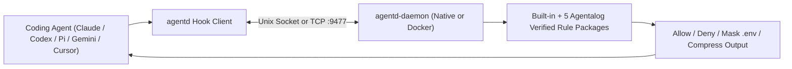

# agentd — Runtime Defense & Guardrails for AI Coding Agents

**Stop destructive commands, credential leaks, and unsafe tool calls before your AI agent executes them.** `agentd` is a sub-millisecond native C++20 defense daemon and hook runtime for **Claude Code**, **Codex**, **Pi**, **Gemini CLI**, **Antigravity**, and **Cursor**. Run it instantly as a Docker container exposing a shared socket or TCP port to your agents, or install the prebuilt native binary package for Linux (`amd64` and `arm64`) and macOS.

[](https://hub.docker.com/r/wrpbr/agentd)
[](https://github.com/wrpbr/agentd/releases/tag/v0.1.0)
[](https://github.com/wrpbr/agentd/releases/tag/v0.1.0)
[](https://agentalog.com/guides/agentd-local-defense)
[](LICENSE)

---

## 1. Copy & Paste Agent Self-Setup Prompt (Fastest Way)

Copy and paste the prompt below directly into **Claude Code**, **Codex**, **Pi**, **Gemini CLI**, **Antigravity**, or **Cursor**. Your agent will detect your OS and CPU architecture, verify `SHA256SUMS`, install the prebuilt `agentd` binaries and hooks, and activate all 5 verified defense rule packages from [Agentalog](https://agentalog.com/api/agentd/catalog):

```text
Install and configure agentd (https://github.com/wrpbr/agentd) on this machine to activate local pre-execution defense hooks and verified rule packages from Agentalog (https://agentalog.com/api/agentd/catalog) across all installed coding agents:

1. Detect the OS (`uname -s`) and CPU architecture (`uname -m`: x86_64 -> amd64, aarch64/arm64 -> arm64).
2. Create a temporary directory and download `SHA256SUMS`, `install.sh`, and the prebuilt portable bundle (`agentd-0.1.0-linux-amd64.tar.gz`, `agentd-0.1.0-linux-arm64.tar.gz`, or `agentd-0.1.0-macos-universal.tar.gz`) from `https://github.com/wrpbr/agentd/releases/download/v0.1.0/`.
3. Verify the downloaded archive checksum against `SHA256SUMS` using `sha256sum -c --ignore-missing SHA256SUMS` (or `shasum -a 256` on macOS). Stop immediately if verification fails.
4. Extract the bundle into `~/.local/share/agentd` and run:
   `~/.local/share/agentd/agentd-install --native --native-bin-dir ~/.local/share/agentd --no-feature-ui --agents all`
5. Add the Agentalog verified catalog and install all 5 defense packages:
   `~/.local/bin/agentd --catalog-add https://agentalog.com/api/agentd/catalog || true`
   `~/.local/bin/agentd --catalog-sync`
   `~/.local/bin/agentd --catalog-install agent-governance-core --catalog-install secret-exfiltration-defense --catalog-install production-db-defense --catalog-install supply-chain-defense --catalog-install mcp-tool-defense`
6. Restart the user daemon (`systemctl --user restart safeguard.service` or run `~/.local/share/agentd/agentd-daemon` in background) and run `~/.local/bin/agentd --print-rules` to confirm all rules are active.
```

---

## 2. Run in Docker in 10 Seconds (Zero-Config for Local Agents)

Any developer or AI agent can download just `docker-compose.yml` and start `agentd` in one command. The container automatically wires the local hook clients into your `$HOME` (`Claude Code`, `Codex`, `Pi`, `Gemini CLI`, `Antigravity`, `Cursor`), syncs the 5 verified rule packages from [Agentalog](https://agentalog.com/api/agentd/catalog), and exposes both the default Unix socket (`/tmp/safeguard/safeguard-daemon.sock`) and TCP port (`127.0.0.1:9477`):

```bash
# Download only docker-compose.yml and start agentd
curl -fsSLO https://raw.githubusercontent.com/wrpbr/agentd/main/docker-compose.yml
docker compose up -d
```

That's it — your local coding agents automatically discover `/tmp/safeguard/safeguard-daemon.sock` with zero extra environment variables. If you connect from another container or over TCP (macOS / Windows / remote Docker network), point the agent at:

```bash
export AGENTD_DAEMON_SOCKET=tcp://127.0.0.1:9477
```

### Other Container & Cloud Runtime Templates Included

- **Podman & Podman Quadlet (Rootless):** Run `podman compose up -d` with the same `docker-compose.yml`, or install [`containers/podman/agentd.container`](containers/podman/agentd.container) into `~/.config/containers/systemd/` for rootless systemd management on Fedora, RHEL, Rocky, and AlmaLinux.
- **VS Code / Cursor Dev Containers & GitHub Codespaces:** Copy [`.devcontainer/devcontainer.json`](.devcontainer/devcontainer.json) into your project to automatically provision `agentd` and all 5 Agentalog rule packages whenever a Dev Container, Cursor workspace, or Codespace starts.
- **Kubernetes Sidecar Pod:** Apply [`kubernetes/agentd-sidecar.yaml`](kubernetes/agentd-sidecar.yaml) to run `wrpbr/agentd` as a low-overhead sidecar container sharing an in-memory Unix socket (`/run/agentd/safeguard-daemon.sock`) and TCP port `9477` with autonomous coding agent pods.

---

## 3. Install Native Prebuilt Packages (Linux `amd64` / `arm64` & macOS)

If you prefer running the native daemon directly on your workstation or server without Docker, run the universal installer or install the package for your distribution from [GitHub Releases](https://github.com/wrpbr/agentd/releases/tag/v0.1.0):

```bash
# One-line universal installer (auto-detects amd64/arm64, deb, rpm, pacman, apk, macOS, or portable tarball, and verifies SHA256SUMS)
curl -fsSL https://github.com/wrpbr/agentd/releases/download/v0.1.0/install.sh | sh
```

Or install manually with your system package manager:

```bash
# Debian / Ubuntu (amd64 or arm64)
sudo apt install ./agentd_0.1.0_amd64.deb

# Fedora / RHEL / Rocky / Alma / openSUSE (x86_64 or aarch64)
sudo rpm -Uvh ./agentd-0.1.0-1.x86_64.rpm

# Arch Linux / CachyOS / Manjaro (x86_64 or aarch64)
sudo pacman -U ./agentd-0.1.0-1-x86_64.pkg.tar.zst

# Alpine Linux (x86_64 or aarch64)
sudo apk add --allow-untrusted ./agentd-0.1.0-r0.x86_64.apk

# Activate hooks across all installed coding agents
agentd-install --native --no-feature-ui --agents all
```

Supported coding agents configured out of the box (`--agents all` or `--agents claude,codex,pi,gemini,antigravity,cursor`):
- **Claude Code:** `~/.claude/settings.json`
- **Codex:** `~/.codex/hooks.json`
- **Pi:** `~/.pi/agent/extensions/safeguard.ts`
- **Gemini CLI:** `~/.gemini/settings.json`
- **Antigravity:** `~/.gemini/config/hooks.json`
- **Cursor:** `~/.cursor/hooks.json`

---

## 4. Five Verified Defense Rule Packages Included Free

`agentd` includes built-in policies (command guardrails, secret masking on `.env` reads, oversized file blocks, output compression, subagent call/byte budgets, and TypeScript/JavaScript repository maps) plus **5 SHA-256 verified rule packages** synced from [Agentalog](https://agentalog.com/api/agentd/catalog):

| Package ID | What It Blocks Before Execution |
| :--- | :--- |
| `agent-governance-core` | Remote `curl` or `wget` scripts piped directly into `sh` or `bash`, plus secret-read telemetry. |
| `secret-exfiltration-defense` | Outbound `curl`, `wget`, `nc`, `scp`, or `rsync` commands leaking `.env`, SSH/GPG private keys, AWS credentials, or inline GitHub/GitLab/OpenAI/Anthropic/Slack/AWS tokens, plus direct file reads of private keys. |
| `production-db-defense` | `DROP DATABASE`, `DROP SCHEMA`, `TRUNCATE TABLE`, Redis `FLUSHALL`/`FLUSHDB`, `terraform destroy`, `pulumi destroy`, `kubectl delete namespace/pvc`, `docker compose down -v`, and `git push --force` to `main`/`master`. |
| `supply-chain-defense` | Unverified remote package execution over raw HTTP/tarball URLs (`npx`, `npm install`, `pip --extra-index-url http://`) and tampering with `.ssh/authorized_keys` or `/etc/sudoers`. |
| `mcp-tool-defense` | File write/edit or MCP tool calls targeting `/etc/shadow`, `/etc/sudoers`, SSH private keys, or writing PEM/OpenSSH private keys into workspace files. |



---

## 5. Protect Remote MCP Servers & Require Human Approval with Agentalog

Local hooks protect shell commands and workspace files on your machine. When your agents connect to external **MCP servers** or third-party **skills**, connect `agentd` with **[Agentalog](https://agentalog.com)**:

- **Start Free (3 Protected Services Included):** Every signed-in account at [agentalog.com](https://agentalog.com) includes **3 free protected MCP servers or verified skill copies** with zero upfront payment.
- **Pin Tool Definitions by SHA-256:** The Agentalog MCP Protection Gateway (`/g/:id/mcp`) pins every tool definition and server instruction on first use. Silent upstream tool changes are held before they reach your agent.
- **Per-Call Human Approval for Sensitive Tools:** Mark sensitive MCP tools (`execute_sql`, `delete_record`, `send_email`, `transfer_funds`) as `gated_tools`. When an agent calls a gated tool, the gateway computes the SHA-256 of the exact arguments, pauses the call, and waits for your single-use approval in the Agentalog dashboard.
- **Verified Skill Copies:** Inspect any public skill file-by-file with `GET https://agentalog.com/api/skills/:id/verification` and install the immutable Agentalog-verified copy instead of pulling unreviewed upstream changes.

Read the full integration guides on Agentalog:
- [Local Agent Defense with agentd & Agentalog](https://agentalog.com/guides/agentd-local-defense)
- [MCP Protection Gateway & Per-Call Human Approval](https://agentalog.com/guides/mcp-protection-gateway)

---

## CLI Quick Reference

```bash
agentd                             # Open interactive rules, catalog, and settings console
agentd --setup-prompt              # Print the copy-paste self-configuration prompt for any agent
agentd --print-rules               # List all active built-in and catalog rules
agentd --catalog-add https://agentalog.com/api/agentd/catalog
agentd --catalog-sync              # Sync verified rule catalogs
agentd --catalog-install secret-exfiltration-defense
agentd --set-rule 910300=on        # Enforce or toggle an individual rule
```

Audit events are written locally to `~/.claude/.statusline/events.jsonl`.

---

Built and maintained by **[WRP](https://agentalog.com)** · [Security Policy](SECURITY.md) · [MIT License](LICENSE)
